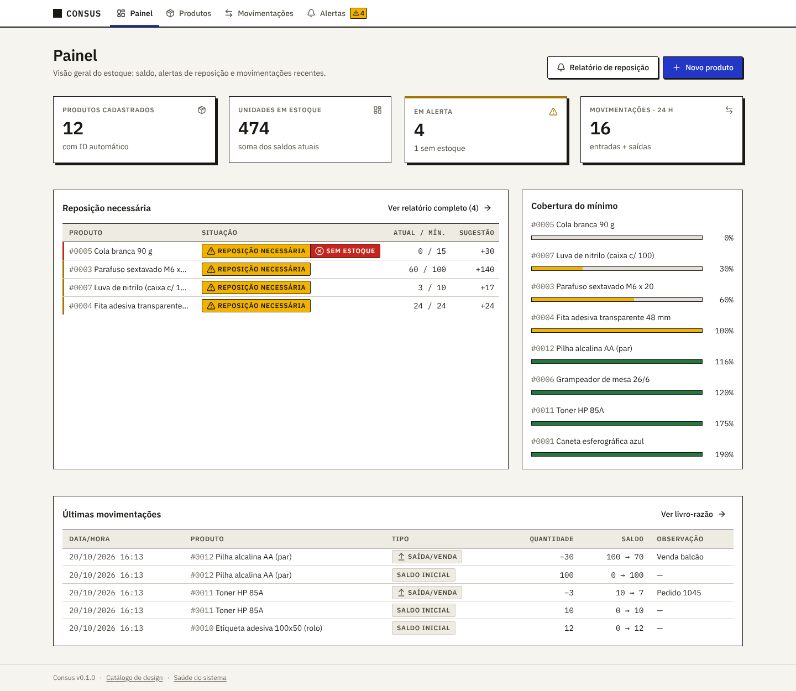
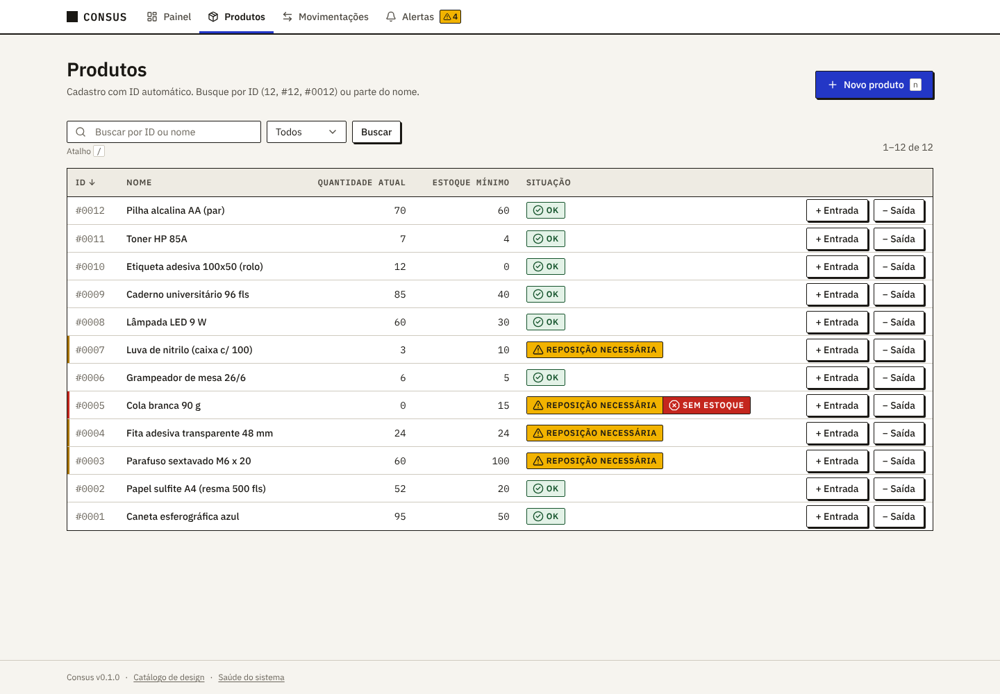
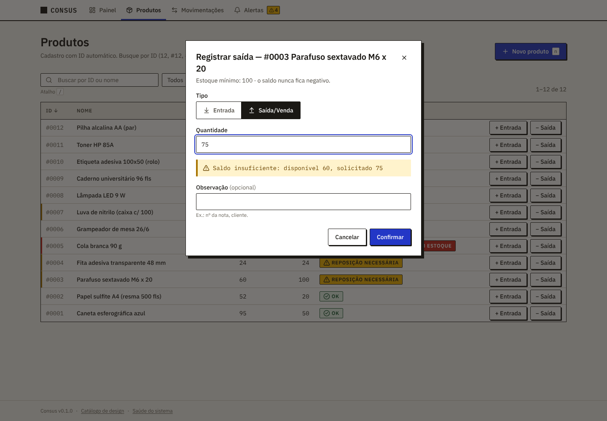
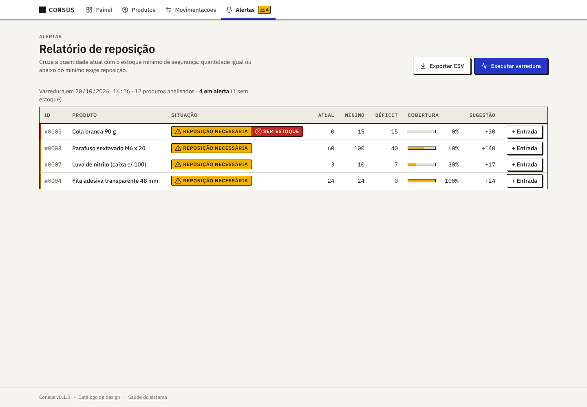
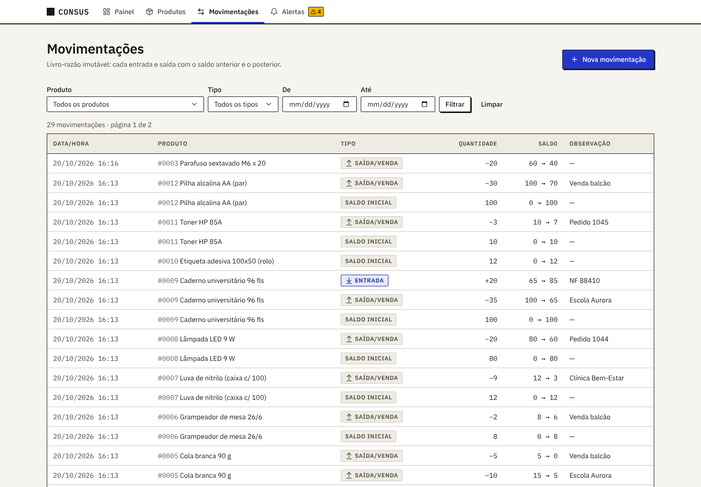
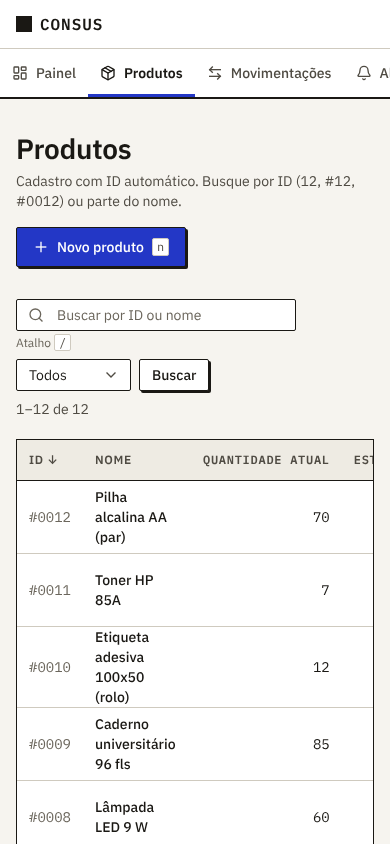

# Consus

> *Consus*: divindade romana guardiã dos grãos armazenados nos celeiros.

Sistema web de **Controle de Estoque Simples**, porém altamente funcional: cadastro de produtos
com ID automático, entradas e saídas com bloqueio de saldo negativo e alerta automático de
reposição. Feito em **Django 5.2 + HTMX 2**, com PostgreSQL no Docker.

Esse repositório deve conter o conteúdo dos códigos, como optei por HTMX não terá API no
momento então terá somente um repositório.



## A atividade, item por item

| Item da atividade | Onde está no Consus |
|-------------------|---------------------|
| **1. Cadastro**: nome, quantidade inicial e estoque mínimo de segurança; ID numérico automático | **Produtos** (`/produtos/`) → *Novo produto* (atalho `n`). O ID é gerado pelo banco e exibido como `#0001`; a busca aceita `12`, `#12`, `#0012` ou parte do nome. A quantidade inicial vira o primeiro lançamento do livro-razão (*Saldo inicial*). |
| **2. Movimentação**: entrada soma, saída/venda subtrai, saldo nunca negativo | Botões **+ Entrada / − Saída** em cada linha, no detalhe do produto e em **Movimentações** (`/movimentacoes/`). A prévia mostra o saldo resultante enquanto você digita e bloqueia a saída maior que o disponível. A regra é garantida em três camadas: formulário, serviço transacional com `SELECT … FOR UPDATE` e `CHECK` no banco. Todo lançamento fica no livro-razão, que é imutável. |
| **3. Alerta de baixa**: quantidade ≤ mínimo → **⚠ REPOSIÇÃO NECESSÁRIA** em destaque | Selo em todas as telas, **Relatório de reposição** (`/alertas/`) ordenado por criticidade, com sugestão de compra e exportação CSV. O contador no menu se atualiza sozinho (varredura automática) e o comando `varrer_estoque` faz a varredura pelo terminal. Estoque zerado aparece também como **SEM ESTOQUE**. |

| Produtos | Saída bloqueada (saldo insuficiente) |
|----------|--------------------------------------|
|  |  |

| Relatório de reposição | Livro-razão |
|------------------------|-------------|
|  |  |

## Como executar

Pré-requisitos: [Docker](https://docs.docker.com/get-docker/) com o plugin Compose.

```bash
cp .env.example .env          # revise os valores se quiser
docker compose up --build     # app + PostgreSQL 17, migrações automáticas
```

Abra <http://localhost:8000>. Com `CONSUS_POPULAR_DEMO=1` (padrão do `.env.example`) o banco
começa com 12 produtos de demonstração, 4 deles em alerta.

| Endereço | O que é |
|----------|---------|
| `/` | Painel: KPIs, produtos críticos, cobertura do mínimo e últimas movimentações |
| `/produtos/` | Cadastro, busca por ID/nome, filtro por situação |
| `/movimentacoes/` | Livro-razão com filtros e nova movimentação |
| `/alertas/` | Relatório de reposição (`?formato=csv` exporta) |
| `/design/` | Catálogo vivo do design system |
| `/saude/` | Verificação de saúde (JSON) |

O contador de alertas do menu consulta o servidor a cada `ALERTAS_INTERVALO_SEGUNDOS`
(padrão 30, mínimo 5) e também logo após qualquer movimentação. Mudanças são anunciadas a
leitores de tela.

### Pelo terminal

```bash
docker compose exec app python manage.py varrer_estoque                 # relatório em texto
docker compose exec app python manage.py varrer_estoque --formato csv   # ou json
docker compose exec app python manage.py varrer_estoque --todos         # inclui os produtos OK
docker compose exec app python manage.py varrer_estoque --falhar-se-alerta
docker compose exec app python manage.py movimentar 12 saida 3 --obs "Pedido 1045"
docker compose exec app python manage.py popular_demo                   # idempotente
```

`varrer_estoque` só lê o banco. Códigos de saída: `0` sem problemas, `1` há produto em alerta
(apenas com `--falhar-se-alerta`), `2` o banco não pôde ser consultado. Exemplo de cron que
avisa toda manhã:

```cron
0 7 * * 1-5  cd /srv/consus && docker compose exec -T app python manage.py varrer_estoque --falhar-se-alerta || mail -s "Consus: reposição" compras@exemplo.com
```

### Sem Docker (desenvolvimento)

```bash
uv sync                                   # Python 3.13 + dependências
DJANGO_DEBUG=true uv run python manage.py migrate
DJANGO_DEBUG=true uv run python manage.py popular_demo
DJANGO_DEBUG=true uv run python manage.py runserver
```

Sem `DATABASE_URL`, o Consus usa SQLite local.

## Design

Estratégia **High-Density Neo-Brutalism Sóbrio / Swiss Grid Enterprise**: grade de 12 colunas,
bordas de 1 px, sombras sólidas deslocadas, IBM Plex Sans/Mono (números tabulares), cor só
onde há significado (alerta, erro, ação primária) e contraste WCAG AA verificado por teste.
Os tokens ficam em [`static/css/tokens.css`](static/css/tokens.css) e o restante do CSS só
os referencia. Funciona sem JavaScript: HTMX apenas melhora a experiência.



## Qualidade

| Comando | Verifica |
|---------|----------|
| `uv run ruff check .` | lint |
| `uv run ruff format --check .` | formatação |
| `uv run pytest` | testes + cobertura (mínimo 90 %) em SQLite |
| `uv run python manage.py makemigrations --check --dry-run` | migrações em dia |
| `uv run python manage.py checar_contraste` | contraste WCAG AA dos tokens |
| `docker compose --profile testes run --rm testes` | suíte completa no PostgreSQL (concorrência e desempenho incluídos) |
| `uv run pytest -m docker` | integração com Docker Compose (sobe e derruba um ambiente isolado) |

## Como o projeto foi especificado

Desenvolvimento orientado por especificação com o [GitHub Spec Kit](https://github.com/github/spec-kit):

- [`.specify/memory/constitution.md`](.specify/memory/constitution.md): princípios do projeto;
- [`docs/arquitetura.md`](docs/arquitetura.md): contrato compartilhado entre as features;
- [`docs/design/`](docs/design/): design system e as referências estudadas (shadcn/ui, Tremor,
  Carbon, design-resources-for-developers, Refactoring UI);
- [`specs/`](specs/): uma pasta por atividade, cada uma com `spec.md`, `plan.md`, `tasks.md`,
  contratos e checklists:
  1. [`001-fundacao-design-system`](specs/001-fundacao-design-system/): layout, design system, Docker;
  2. [`002-cadastro-produtos`](specs/002-cadastro-produtos/): item 1 da atividade;
  3. [`003-movimentacao-estoque`](specs/003-movimentacao-estoque/): item 2;
  4. [`004-alerta-reposicao`](specs/004-alerta-reposicao/): item 3;
- [`docs/rastreabilidade.md`](docs/rastreabilidade.md) e
  [`docs/auditoria-especificacoes.md`](docs/auditoria-especificacoes.md): auditoria das specs
  contra o enunciado.

Branches: cada feature nasce de `develop` (`NNN-slug`) e volta por merge `--no-ff`;
`main` recebe apenas releases vindas de `develop`.
